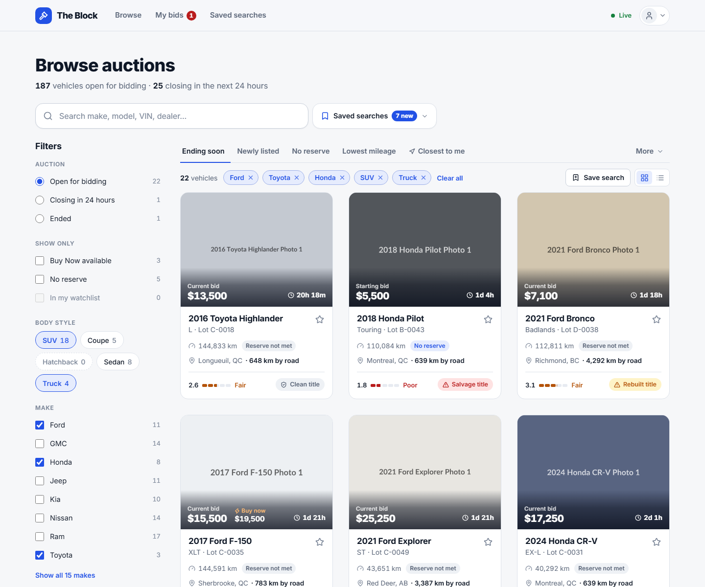
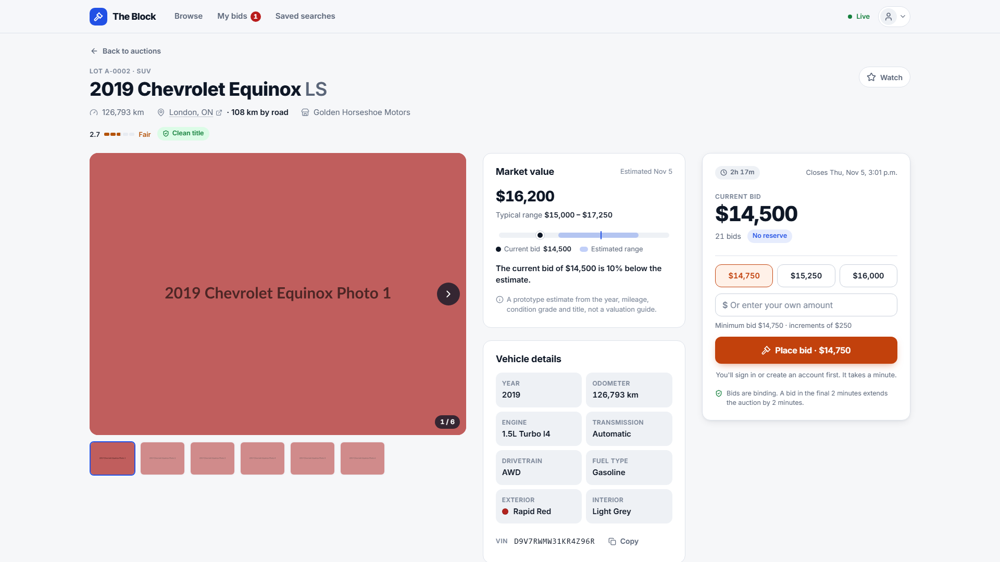
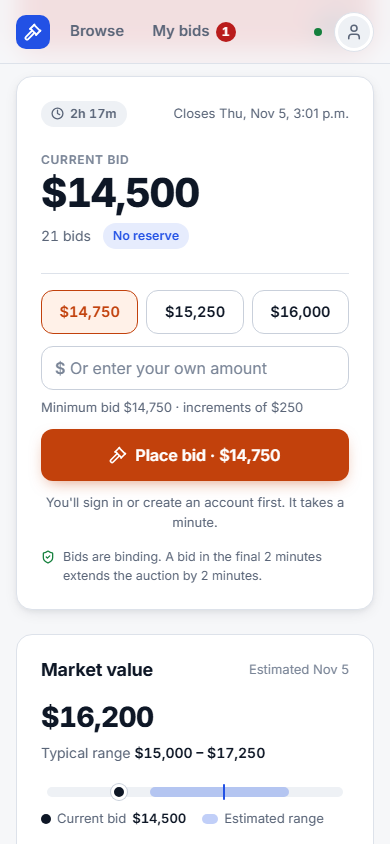
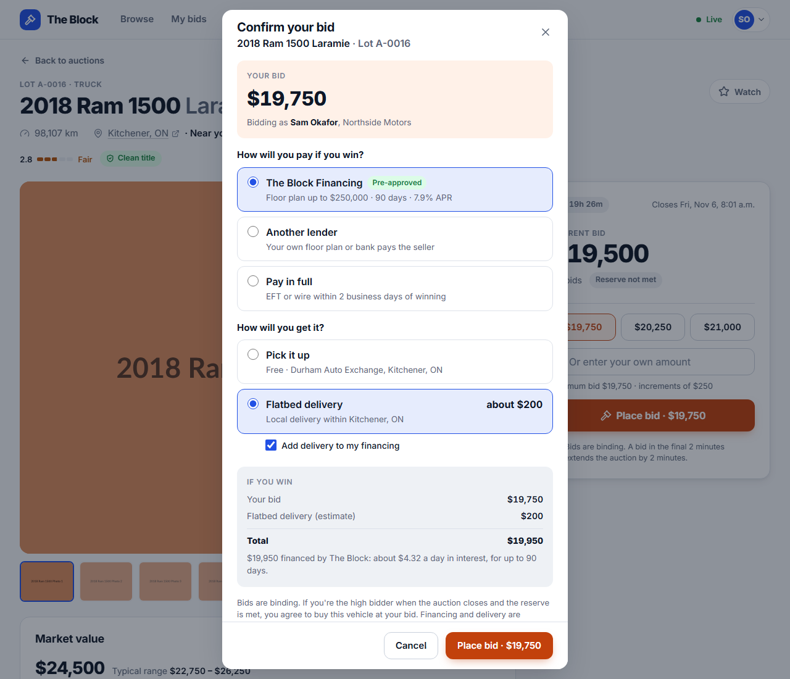
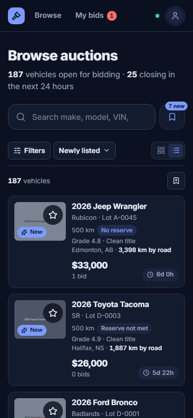
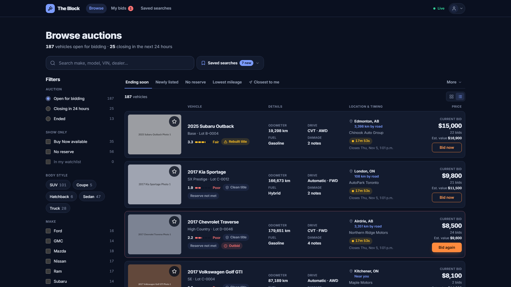

# The Block

**A buyer-side vehicle auction prototype.** Browse and search 200 dealer vehicles in a photo grid or a dense dealer list, save searches, sort by what's closest to you, compare each bid with an estimated market value, inspect condition and damage, and bid in live auctions that update across every open tab.

Angular 21 · NestJS 11 · SQLite. The original challenge brief is in [`docs/CHALLENGE.md`](docs/CHALLENGE.md).

<p align="center">
  
</p>

<p align="center">
  
  
</p>

<p align="center">
  
  
</p>

<p align="center">
  
</p>

---

## How to Run

**Requirements:** Node.js **20.19+, 22.12+ or 24+** (see `.nvmrc`) and npm. You don't need Docker, a database server or any env vars.

```bash
npm install     # installs both apps (npm workspaces)
npm run dev     # API on :3000 + Angular dev server on :4200
```

Open **http://localhost:4200**.

On first start, the API creates a SQLite database and seeds it from `data/vehicles.json`, with auction times re-anchored to the current time.

| Command | What it does |
|---|---|
| `npm run dev` | API (watch mode) and Angular dev server with live reload. The web app proxies `/api` to the API. |
| `npm start` | Production build of both apps, served from **one port**: http://localhost:3000 |
| `npm test` | API unit and e2e tests (Jest), then web unit tests (Vitest) |
| `npm run db:reset` | Deletes the database so the next start re-seeds it with fresh auction times. Stop the API first. |

**Optional settings** (environment variables for the API):

| Variable | Default | Purpose |
|---|---|---|
| `SIMULATE_BIDDING` | `true` | Rival dealers who bid against you. Set it to `false` for a quiet auction. |
| `PORT` | `3000` | API port. If you change it, update `apps/web/proxy.conf.json` for dev mode. |
| `DB_PATH` | `apps/api/data/auction.sqlite` | SQLite file location |
| `ROUTING_URL` | `https://router.project-osrm.org` | OSRM server for driving distances. Set it to `off` to use straight-line distances only. |

### A two-minute tour

1. **Browse.** Search "ford", choose **Truck** under Body style, and pick **Lowest price** from *More*. Each filter appears as a chip above the results (click its × to remove it), and the counts beside every option update to match. The URL updates as you go, so the view can be shared and survives a refresh. Then clear the search and tick **Salvage** under Title status to see how risky titles are flagged.
2. **Quick sorts and layouts.** Try the tabs above the results: **Newly listed**, **No reserve**, **Lowest mileage**, and **Closest to me** (use your device location, or search for any city, address or postal/ZIP code in Canada or the US). Every lot then shows how far away it is. Switch between the **grid** and **list** views with the toggle on the right. Keep scrolling: more lots load automatically, and **Back** from a vehicle returns you to the same spot.
3. **Save a search.** With a filter applied, choose **Save search** beside the chips. Open it again from **Saved searches** next to the search box, with a match count and how many matches are *new* (listed in the last 24 hours). Rename or delete searches on the **Saved searches** page.
4. **Inspect** a vehicle: photos, an estimated **market value** with the current bid plotted against it, specs, a condition grade, damage notes sorted by severity, the seller (open their city in Google Maps from the header or *Sale information*), and a bid history. In the list view, every row shows the estimate under the price.
5. **Bid.** Pick a quick-bid amount and press **Place bid**. As a guest you're asked to sign in or create an account first (simulated), then you land straight in the confirmation. It asks how you'll pay if you win (*The Block Financing*, another lender, or pay in full) and whether you'll pick the car up or have it delivered by flatbed, with a quote from your road distance and the option to add it to your financing. Confirm, and the panel switches to *You're the high bidder*. Bid on a second car: your choices are remembered and shown on two lines with *Change*.
6. **Get outbid.** Within a few seconds a simulated rival may answer your bid. You'll get a toast with **Bid again**, the panel turns red, and **My bids** shows a badge. To play both sides yourself, open a **private window** and create a second account there: it gets its own anonymous buyer identity.
7. **Buy Now** a vehicle that shows a ⚡ Buy now price, **star** a few vehicles, then open **My bids** to see the bidding, ended and watchlist tabs.
8. Open the **account menu** (top right) to switch between *Light*, *Dark* and *Auto* themes, change your location, or try **Sign in** and **Create account** (a simulated flow). Resize to phone width to see the filter sheet and sticky bid bar.

---

## Time Spent

_TODO (author): add your time and how you approached the time box._

The work was split into cut lines (see [Notable Decisions → Scope](#scope-and-cut-lines)), so the minimum bar was met before any extras were started.

## Assumptions and Scope

**Included**
- Inventory browsing with free-text search, filters whose counts follow your other choices, removable filter chips, 9 sort orders and five one-tap quick sorts (*Ending soon, Newly listed, No reserve, Lowest mileage, Closest to me*). Filtering, sorting and paging happen on the server, and results load as you scroll.
- Two layouts: a **photo grid** and a **dense list** for scanning many lots. Grid cards carry the price, Buy Now and time left in one bar across the photo. Cards and rows show condition, title status, a *Reserve not met* or *No reserve* pill, a *New* badge and distance; list rows add the estimated value.
- An **estimated market value** for every lot: a range, and a plain-language comparison with the current bid.
- **Saved searches** on their own page (open, rename, delete), with live match counts and a "new in the last 24 hours" count.
- **Closest to me**: your device location, or any city, address or postal/ZIP code in Canada or the US, to sort by distance and show km on every lot.
- **Open in Google Maps** for each vehicle's location.
- A full vehicle detail page: gallery, specs, condition report, damage notes sorted by severity, selling dealership and bid history.
- Bidding with tiered increments, a confirmation step, soft close (anti-sniping), and server-side validation of every bid. Bidding asks you to sign in, and the confirmation asks how you'll pay and take delivery (simulated in-house financing, another lender or pay in full; pickup or a flatbed delivery quote).
- Buy Now.
- Live updates over server-sent events, plus simulated rival bidders.
- **My bids** (bidding, ended, watchlist) and a **Watchlist**.
- An **account menu** with shortcuts, location, appearance (light, dark or follow the system) and a simulated sign-in and sign-up flow.
- Light and dark themes, and responsive layouts from phones up to 1440p monitors.

**Assumptions**
- **No real accounts.** Each browser gets an anonymous buyer id (a UUID in `localStorage`). A private window counts as a second buyer. *Sign in* and *Create account* are a simulated flow: the form is validated like the real thing and your name is remembered in this browser, but nothing is sent to a server and the password is never stored.
- **Financing and delivery are simulated.** Every signed-in dealer is "pre-approved" for a $250,000 floor plan at 7.9% APR for up to 90 days. Flatbed delivery is estimated at $150 plus $1.20 per road km (at least $200). The choices are remembered in this browser with the account; no lender or carrier is contacted.
- **All prices are CAD.** The dealerships are in Canada; buyers can be anywhere in Canada or the US.
- **The dataset's photos are placeholders.** Each is tinted with the car's exterior colour (toned to suit the theme), to suggest what a real photo would show.
- **The seller's reserve price stays private.** Buyers only see *Reserve met*, *Reserve not met* or *No reserve*.
- **Listing dates are derived.** The dataset has no "listed on" date, so each lot is listed six to eight days before it closes. It is never listed in the future, and always before its first bid.
- **Market values are estimates.** A simple book-value model (a typical price for the model's segment × age × mileage × condition × title), not a valuation feed. It never uses the reserve, so it can't leak what a seller will accept.
- **Distances are driving distances between city centres.** Each dealership city has approximate coordinates, and the distance is the road route from your location to that city centre. If the routing service can't be reached, the app falls back to straight-line distance and labels it *km away* rather than *km by road*. The dataset has no street addresses (and the dealer names are made up), so *Open in Google Maps* goes to the dealer's city rather than a storefront.

**Intentionally skipped**
- Real authentication (sign-in is simulated).
- Proxy or max bidding.
- Real payments, credit decisions and transport booking (the payment and delivery choices are simulated).
- Seller and admin tools.
- Push notifications.
- Internationalization.

## Stack

- **Frontend:** Angular 21 (standalone components, signals, zoneless change detection, new control flow), Angular CDK (dialog, menu, focus trap), Reactive Forms for the sign-in dialog only, hand-built SCSS design tokens. No UI kit.
- **Backend:** NestJS 11 (Express), `class-validator` DTOs, server-sent events for live updates.
- **Database:** SQLite via `better-sqlite3`, with hand-written SQL in three small repositories.
- **Tooling:** npm workspaces, `concurrently`, Jest + supertest (API), Vitest (web).

## What I Built

```
apps/
  api/                 NestJS
    src/auctions/      auction-rules.ts — all bidding rules as pure functions (+ tests)
    src/database/      SQLite connection, schema, repositories, seed (schedule, listing dates, city coordinates, bid history)
    src/vehicles/      search / facets / detail endpoints, DTOs, row → response mapper, market value estimate
    src/bids/          the single write path for bids and Buy Now (one transaction each)
    src/bidders/       anonymous identity and buyer location headers, /me, my bids, watchlist
    src/saved-searches/ save / list / delete, canonical query keys, match and "new" counts
    src/events/        in-process pub/sub + SSE stream
    src/simulator/     rival bidders
    test/              end-to-end API tests
  web/                 Angular
    src/styles/        design tokens (light/dark), base, shared component classes
    src/app/core/      API client, live-update service, stores, theme, simulated account, purchase plans, place search, clock, toasts
    src/app/layout/    header, account menu, sign-in / create-account dialog and the sign-in-to-bid prompt, toasts
    src/app/shared/    formatting, market value comparisons, location picker, paint colours, icons, status chips, condition meter…
    src/app/features/  inventory (grid card, list row, sort tabs, filter panel, applied chips) · saved-searches · vehicle-detail · my-bids
data/vehicles.json     unchanged seed data
```

**How a bid flows:**

```
Bid panel ──POST /api/vehicles/:id/bids──▶ BidsService
                                            ├─ transaction: read lot → validate (auction-rules) → insert bid → update lot
                                            └─ publish change ──▶ SSE /api/events ──▶ one tab per browser
                                                                                          └─ BroadcastChannel ──▶ the other tabs
                                                                   (cards, detail page, My bids, header badge, toasts)
```

The server is the source of truth for every rule. The client mirrors the minimum-bid and cap checks for instant feedback, but always renders what the server returns.

## Notable Decisions

### Product

- **Auction timing: a car "runs on the block" at `auction_start`.** The dataset's times are all in the past, and 44% of lots already have bids spread across the whole schedule. If `auction_start` meant "bidding opens", most lots would be *upcoming* with 16 bids on them, which doesn't make sense. So bidding is open now and closes when the car crosses the block, much like online proxy bidding ahead of a physical lane. On seed, the schedule is shifted so a few lots have already closed (to show ended states), the next ones close about 20 minutes after first start, and the rest spread over about six days. The original order and spacing are preserved.
- **Soft close.** A bid in the final two minutes extends the close by two minutes, and the lot shows an *extended* chip. This prevents sniping, which matters for trust.
- **The reserve is never revealed.** The bid panel shows *Reserve met / not met / No reserve*, and warns when you're leading but below the reserve. Cards and rows only flag what changes a buyer's read of a lot: *Reserve not met* (it may not sell at today's price) or *No reserve* (it will sell). A met reserve is the normal case and gets no badge.
- **Tiered increments:** $100 under $10k, $250 up to $30k, $500 up to $60k, and $1,000 above that. Quick-bid chips offer the minimum, +2 increments and +5 increments.
- **Buyer protection.**
  - Bidding needs an account. Browsing, watching and saving searches don't, because they commit nothing. A guest who presses *Place bid* or *Buy now* is asked to sign in or create an account, told why (bids are binding, so sellers need to know which dealership they're dealing with), and then taken straight on to the confirmation with the same amount.
  - Every bid and Buy Now goes through a confirmation that restates the amount and shows who is bidding.
  - The confirmation flags bids well above the minimum, a bid that costs more than Buy Now, and salvage or rebuilt titles.
  - A buyer can't outbid themselves.
  - Implausible amounts (over 3× the minimum) are rejected as likely typos.
  - If someone else bids while you're confirming, you get the new minimum and a one-tap rebid instead of a vague error.
- **How you'll pay and take delivery, asked when you commit.** A bid is a promise to buy, so the confirmation asks the two questions a dealer has to answer if they win:
  - **Payment:** *The Block Financing* (in-house floor plan, shown first because most wholesale purchases are floor-planned), *another lender* (your own floor plan or bank, by name), or *pay in full* by EFT or wire within two business days. Floor plan cost is shown per day ("about $4.32 a day in interest"), the way dealers think about it.
  - **Delivery:** pick it up from the dealer, or flatbed delivery quoted from the driving distance to your location, with *Add delivery to my financing* when you finance with The Block. Without a location, the quote asks you to set one right there.
  - An *If you win* box totals the bid and delivery and says in one sentence who pays what, and when.
  - It asks in full once, then remembers. Later confirmations show two lines with *Change*, so a dealer bidding all day isn't re-asked every time. A remembered choice that no longer fits (no location for delivery, or a price above the financing limit) reopens the full form.
- **Disclosures are surfaced, not buried.**
  - Salvage and rebuilt titles appear as red and amber chips on cards and on the detail page.
  - Damage notes are classified as *major* (frame, flood, airbag), *mechanical* or *cosmetic*, and sorted with the most serious first.
- **Simulated rivals.** In a solo demo you'd never get outbid, so a background simulator answers about 75% of real bids within 4–15 seconds and places occasional bids elsewhere. Each lot has a hidden *market ceiling* above which rivals stop, so you can always win. Rival bids go through the same `BidsService` as real ones. Set `SIMULATE_BIDDING=false` to turn it off.
- **Grid or list: two marketplaces in one.** Consumer auction sites lead with big photos and a handful of facts. Wholesale sites are dense tables a dealer can scan in seconds. Each suits a different moment, so the inventory offers both and remembers the choice.
  - The **grid** is photo-first, with the quick-sort tabs consumer buyers know. Each card has one bar across the bottom of its photo: the price, large, on the left; Buy Now beside it when offered; time left on the right, turning amber then red near the close. It replaced a price block under the photo, then a cluster of separate tags (timer, price, Buy Now, star), which I mocked side by side with two alternatives before choosing.
    - The bar is a soft dark fade rather than a box, so white text reads on any paint colour, and on a real photo it would look like the usual caption scrim.
    - Buy Now is a second price column with a light-orange label, not a solid orange pill: it still reads as the action price without competing with the bid.
    - The top of the photo stays clear unless something is about you (*Winning*, *Outbid*) or the lot is *New*. The watch star sits beside the vehicle's name.
    - The bid count moved to the detail page. On a card it was one more number to parse, and the price already says how the bidding is going.
    - The reserve pill sits beside the odometer, and condition and title sit at opposite ends of the footer so each reads on its own. Lots in your own city say *Near you* rather than "0 km".
  - The **list** has one column per question a dealer asks: *what is it* (title, trim, lot, grade, title status), *what shape is it in* (odometer, drivetrain, fuel, damage count), *where and when* (city, distance, dealer, countdown) and *how much* (bid, reserve status, estimated value, Buy Now, **Bid now**). On a phone it collapses to a compact row, so you see more lots per screen.
  - On wide monitors the container grows to 2000 px and the grid to five columns, so a 1440p screen isn't mostly margin. The detail page adds a third column (gallery, then vehicle details and sale information, then the bid panel), so everything a dealer checks fits above the fold.
- **Quick sorts are mutually exclusive tabs.** *No reserve* shows only no-reserve lots, ending soonest first. Leaving that tab (for another tab or a sort under *More*) drops the filter it set, but a *No reserve* filter set in the sidebar is kept. Less common sorts sit under **More** at the end of the same row; on phones every sort is in one **Sort** menu.
- **Filtering that explains itself.** The first version stacked four rows of controls (saved chips, status pills, sort tabs, a sort dropdown) and made you scroll the sidebar to see what was applied. Now:
  - Everything above the results fits in two rows: sorts, then the count, what's applied and Save. On a phone it's one row: *Filters · Sort · layout*.
  - Auction status (open, closing in 24 hours, ended) moved into the filters, where it belongs, so "Closing soon" no longer sits next to the "Ending soon" sort.
  - Every applied filter is a chip beside the result count. Each has its own ×, and *Clear all* removes the lot. *Save search* sits right there, because what you save is what you see.
  - Counts next to every option follow your other filters (tick Ford and the body styles show how many Ford trucks there are). Options with no matches stay visible but greyed out, so the panel doesn't reshuffle under your cursor.
  - Results stay on screen, dimmed, while the next set loads, instead of flashing back to skeletons. The page no longer jumps to the top on every change; if you filtered from deep in the list, it scrolls just to the top of the new results.
- **Estimated market value.** A dealer's first question about a price is "is that good?" Every lot carries a book-value estimate with a ±7% range, computed from the same kinds of factors a valuation guide uses: segment, age, mileage against about 18,000 km a year, condition grade and title. It shows in two places:
  - The **list view** shows it under the price. That's where dealers compare lots, and where wholesale sites show a value.
  - The **detail page** has a *Market value* card: the estimate, the range, a small gauge placing the current bid (and Buy Now) against it, and one sentence such as "The current bid of $27,000 is 12% below the estimate."
  - Grid cards stay photo-first and don't show it, to keep them light.
  - It's labelled as a prototype estimate everywhere it appears. In production it would come from a valuation provider or the marketplace's own sale prices.
- **Closest to me is opt-in, and uses where you really are.** Nothing asks for location until you choose that sort. You can share your device location, which is named by its town (*Buffalo, NY*), or search for any city, street address or postal/ZIP code in Canada or the US. An earlier version only let you pick a dealership city and labelled your device by its nearest dealer, so a buyer in Buffalo was told they were "near Hamilton". Dealers often buy across the border, so that was wrong.
  - Place search uses [Photon](https://photon.komoot.io) (OpenStreetMap data): no API key, so the app still runs from a clone. Results are limited to North America, so "London" means Ontario or Kentucky, not England.
  - Only a position rounded to about 1 km is sent to name your town. If the lookup fails, the location still works and is just called *Your current location*.
  - **Distances are by road.** The first version used straight-line distance, which in review came out at 352 km for a trip Google Maps puts at about 420 km by car. Around the Great Lakes, and anywhere a ferry is involved, the gap is larger still. Pickup and transport are priced by road, so the API asks an [OSRM](https://project-osrm.org) routing server for driving distances from your location to all 36 dealership cities in a single request. Toronto → Windsor now reads 372 km by road (Google Maps: about 370). The answer is cached per location, so only the first request pays for it (about half a second). If routing is unavailable the app falls back to straight-line distance, labelled differently.
  - The location is kept in the browser and sent to the API in an `X-Buyer-Location` header rather than the URL, so it never ends up in a shared link, a saved search or an access log.
- **Saved searches are stored on the server** under the anonymous buyer id. Each is keyed on a canonical query string (sorted keys and values, defaults dropped). Saving the same filters again in a different order renames the existing search instead of creating a duplicate. The "new" count gives a reason to come back: matches listed in the last 24 hours. Saved searches have their own page (open, rename, delete), reached from the header, the account menu and the **Saved searches** button beside the search box. They used to be a tab in My bids, but a search is about the market, not about your bids.
- **An account menu, like a live site.** The avatar in the header opens who you are (a guest, or your name and dealership), the handle other bidders see, shortcuts to My bids (with outbid count), Watchlist and Saved searches (with new matches), your location, and appearance (*Light*, *Dark* or *Auto*, which follows the system). *Sign in* and *Create account* open a dialog that behaves like the real flow: inline validation, show/hide password, a busy state, then a signed-in avatar and a welcome toast. It's simulated, so the README and the dialog both say so. Because bidding identity stays the anonymous id, everything done as a guest carries over to the "account". Signing out forgets the remembered payment and delivery choices.
- **Photos tinted with the car's colour.** The dataset's photos are the same grey placeholder with a caption, so every card looked identical. Each placeholder is now tinted with the lot's exterior colour (*Rapid Red*, *Lunar Silver*, *Midnight Blue*…), toned down to sit calmly in either theme, with a caption colour picked for contrast. The grid gains colour and is easier to scan, and it previews how real photos would change the page. The detail page shows a matching swatch beside *Exterior*. Real photo URLs would pass through untouched.
- **Open in Google Maps.** The vehicle's city in the detail header, and *Sale information*, open Google Maps in a new tab (the universal URL opens the Maps app on phones).
- **Infinite scroll keeps your place.** The next page loads before you reach the end. If you open a lot and press Back, you return to the same scroll position with everything you'd loaded. Live updates keep that list current while you're away. Without this you'd land at the top with only 24 results.
- **Anonymous identity.** The server turns the browser's UUID into a public handle ("Bidder 4821"). Raw ids are never broadcast, so a client can't impersonate another buyer over the live stream.

### Technical

- **SQLite + `better-sqlite3`, no ORM.** It's zero-setup for reviewers, and prebuilt binaries cover macOS, Linux and Windows. Three tables don't justify an ORM, and plain SQL is easy to read in a walkthrough. Because the driver is synchronous, each bid's read-validate-write runs in one transaction with no interleaving. Sorting and filtering use whitelisted SQL fragments, and all user input is bound as parameters. Moving to Postgres would mean swapping the repositories behind the same interfaces.
- **Pure rules module.** `apps/api/src/auctions/auction-rules.ts` holds increments, status, outcome, reserve status, soft close, Buy Now availability, bid validation and damage severity. It does no I/O and never reads the clock, which makes it trivially testable. A `Clock` provider lets the e2e tests move time forward to exercise soft close.
- **Server-sent events over WebSockets.** Updates only flow server → client, and bids are ordinary POSTs. SSE needs no extra library, reconnects automatically, and works through the Angular dev proxy. A separate closer job announces lots whose timers run out, which is what drives the *You won* notification.
- **One live stream per browser, not per tab.** Over HTTP/1.1 a browser keeps about six connections per site, and each EventSource holds one open. With a stream per tab, the sixth tab of the app never finished loading, which I found while screenshotting and confirmed with eight tabs in headless Chrome. Now whichever tab holds a Web Lock opens the stream and relays updates to the other tabs over a `BroadcastChannel`. When that tab closes, the browser hands the lock to another tab, which opens the stream. Eight tabs now all load, and a bid in one shows in all of them, including after the first tab is closed. Browsers without these APIs fall back to a stream per tab. HTTP/2 would also lift the limit, but needs TLS locally.
- **Distance in SQL.** The buyer's driving distances are passed into the query as one JSON object keyed by city and read with `json_extract`. A registered `distance_km()` function supplies the straight-line fallback. "Closest to me" therefore sorts and pages in the database like every other sort, and without a location it falls back to the default order rather than failing.
- **Routing behind one seam.** `routing/road-distances.ts` holds the OSRM client, an injectable route table, and a per-location cache that shares one lookup between concurrent requests and retries a minute after a failure. Tests swap in a stand-in router, so they never touch the network.
- **Schema versioning.** The database holds only seed data plus demo activity. When the schema version (`PRAGMA user_version`) changes, an old local database is rebuilt and re-seeded on start instead of crashing on a missing column.
- **Container queries** size the list rows and spec grids by the space they actually have (beside the filter sidebar or full width), not by the viewport.
- **Filter counts in SQL.** `GET /api/vehicles/facets` takes the same query as the search. Each option group is counted with every filter *except its own*, so the make list still offers other makes after you pick Ford, while body styles narrow to Ford. That's a handful of `GROUP BY` queries on 200 rows.
- **Market value is computed at read time** by a pure, tested function (`vehicles/market-value.ts`), like the other derived state. It ages with the calendar and never sees the reserve.
- **One geocoding seam.** `core/place-search.ts` is the only code that talks to the geocoder: search, reverse lookup, an 8-second timeout, and labels ("N2G 4G7, Kitchener, ON"). Swapping in a paid geocoder, or proxying through the API, would only touch that file.
- **Smaller first download.** The account menu is rendered with `@defer (on idle)` behind a look-alike placeholder button, and the sign-in dialog (the only user of Angular forms) is imported on demand. The menu, overlay and forms code therefore isn't in the initial bundle.
- **Scroll that respects the reader.** Filter and sort changes are query-string navigations made with the router's per-navigation `scroll: 'manual'`, so the page stays where it is. Back and forward still restore position.
- **Derived state is computed at read time.** Status, outcome, minimum next bid and "my status" aren't stored, so they can't go stale.
- **Frontend state uses Angular signals.**
  - One shared one-second clock drives every countdown, instead of a timer per card.
  - Inventory filters live in the URL, which makes views shareable, survives refresh and keeps the back button working.
  - Stores for *My bids* and *Watchlist* merge live updates. The watchlist toggle is optimistic and rolls back if the request fails.
- **Local icon set.** I initially used the Lucide Angular package, but it ships as one 11 MB module. That bloated the dev bundle to 16 MB and made production builds slow. A one-off script extracted just the icons used (about 50), under Lucide's ISC licence, into `shared/ui/icons.ts`, rendered by a 50-line `svg[appIcon]` component. The initial production bundle is about 97 kB over the wire.
- **`apps/web/scripts/ng.mjs`.** On some Windows + Node 24 setups, `ng build` finishes but never exits because esbuild's helper process keeps Node alive. That would stall `npm start`. The wrapper runs the Angular CLI in-process and exits explicitly.

### Design system

A neutral canvas with **one brand colour and one action colour**, so the eye learns where to act.

| Role | Light | Dark | Used for |
|---|---|---|---|
| **Signal Orange** (`--cta`) | `#C2410C` | `#FF8A3D` | **Only** bid, Buy Now and confirm actions, plus the selected quick bid |
| **Lane Blue** (`--primary`) | `#2251E5` | `#7C9CFF` | Navigation, selected filters and tabs, links, focus rings, *New* badges, distances, saved searches |
| Success | `#15803D` | `#34D399` | Winning, won, reserve met, clean title |
| Warning | `#B45309` | `#FBBF24` | Closing within the hour, rebuilt title, mechanical issues |
| Danger | `#B91C1C` | `#F87171` | Outbid, final five minutes, salvage title, major damage |
| Neutrals | `#F6F7F9` → `#0E1726` | `#0B1120` → `#E7ECF5` | Canvas, surfaces, borders, text |

- In the list view the **Bid now** buttons are outlined in orange. Only *Bid again* (when you've been outbid) is solid, so the one urgent action stands out.
- A clean title shows as a quiet grey chip on cards, so salvage (red) and rebuilt (amber) titles are what catch the eye.
- Applied-filter chips use Lane Blue, the selection colour. The market value gauge draws the estimate's range in Lane Blue and the current bid in neutral ink; only Buy Now is orange.
- Semantic colours appear only in chips and banners, and status is always shown with an icon or label too, never colour alone.
- Text and background pairs target WCAG AA.
- Type is Inter, with tabular numerals for prices and countdowns so digits don't jitter.
- Spacing follows a 4 px grid.
- Motion is limited to subtle price flashes and live pulses, and is turned off under `prefers-reduced-motion`.
- The theme defaults to the system setting (*Auto*) and keeps following it until the user picks *Light* or *Dark*. The choice is remembered and applied before Angular boots, so the page never flashes the wrong theme.

### Scope and cut lines

The build was ordered so that each step leaves a working product:

1. Scaffold and seed
2. Browse
3. Detail
4. **Bid** (the minimum bar is met here)
5. Live updates and rivals
6. My bids, watchlist and single-port mode
7. Polish and docs
8. Second round, from review feedback: quick sorts, newly listed, closest to me, saved searches, infinite scroll, grid and list views, wide-screen layouts
9. Third round, from review feedback: estimated market value, calmer sort and filter controls, a saved searches page, an account menu with simulated sign-in
10. Fourth round, from review feedback: real-world buyer locations (including the US), Google Maps links, colour-tinted photos, shorter cards with prices on the photo

## Testing

```bash
npm test
```

- **API unit tests (Jest, 78):** every rule in `auction-rules.ts`, schedule normalization, listing dates, bid-history generation, distance maths and parsing of the buyer-location header, saved-search canonicalization, driving distances (the OSRM request and parsing, one lookup per location even under concurrent requests, straight-line fallback on failure), and the market value model (each factor, ranges, ageing with the calendar). The bid history is checked to be strictly increasing, to end at the dataset's current bid, to fall between listing and close, and to be deterministic.
- **API end-to-end tests (Jest + supertest, 22):** they boot the real app against an in-memory database with a controllable clock.
  - Default listing, search, filters and validation errors
  - *Newly listed* order, *Closest to me* with and without a valid location, from a buyer in the US, and sorted by driving distance with a stand-in router
  - Filter counts that follow the other filters, and a market value on every lot
  - Detail with seeded history
  - Accepting a minimum bid
  - `BID_TOO_LOW` with the new minimum, no self-outbidding, closed lots
  - Soft-close extension, a missing bidder id
  - Buy Now, and a second Buy Now rejected
  - My bids and watchlist
  - Saved searches: match counts, de-duplication and renaming, per-buyer isolation, "new" counts, validation, delete
- **Web unit tests (Vitest, 92):** URL ⇄ filter mapping, quick-sort tab logic, applied-filter chips, saved-search keys and plain-language summaries, market value comparisons and gauge positions, the simulated account (and that no password is stored), place-search labels (US states, postal codes, addresses, no county noise), the North America limit and the rounded reverse lookup, coordinate rounding and Google Maps links, reserve pills, "new listing" checks and age formatting, countdown formatting and urgency, bid-amount parsing and checks, confirmation warnings, purchase plans (delivery quotes, what gets financed, what blocks a bid, remembering and forgetting on sign-out), the sign-in gate letting a signed-in buyer straight through, live-update merging and "my status", one live stream shared by every tab (and handed over when that tab closes), paint-colour tinting with readable captions, and the theme service (including following the system setting).
- **Manual and browser checks.** I drove the app with headless Chrome at 375, 768, 1024, 1280, 1440, 1920 and 2560 px in both themes, with no console errors:
  - Infinite scroll loads one page per scroll and fills tall screens. Back from a vehicle restores all 168 loaded lots at the same scroll position.
  - *Closest to me* → search "Portland", a ZIP code or a street address, or use a device location (emulated in Buffalo, NY) → named correctly, and lots sorted by distance across the border
  - Save search → naming dialog → toast and *Saved* state; opening a saved search from the menu
  - Filtering from deep in the list lands on the top of the new results, not the top of the page
  - Removing a filter chip, and filter counts updating as filters change
  - Create account → inline validation → signed-in avatar and welcome toast → sign out
  - Account, sort and saved-search menus at phone width
  - As a guest: Place bid → *Sign in to bid* → create account → confirmation with payment and delivery → *You're the high bidder*; a missing lender name blocks the bid with a clear message; a second bid shows the remembered choices
  - A second buyer outbids → banner, toast and header badge update live
  - The mobile filter sheet and the sticky mobile bid bar
  - Eight tabs open at once: all load, all show *Live*, and a bid in one appears in all of them, including after the tab holding the stream is closed
  - `npm start` single-port mode, including deep links

## What I'd Do With More Time

- **Proxy or max bidding** (bid up to a limit, auto-increment), which is standard in wholesale auctions.
- **Real accounts and dealer verification**, replacing the simulated sign-in and the anonymous ids.
- **What happens after a win.** The payment and delivery choices made when bidding would drive the next steps: financing paperwork, booking the carrier and the payment due date. The prototype stops at the bid, which is what the brief asks for, and the choices are kept in the browser rather than attached to the bid on the server.
- **A real valuation feed** (a valuation guide, or the marketplace's own sale prices), plus a "furthest below market" sort built on it.
- **Shared API contract.** Generate the client from an OpenAPI spec, or share DTO types in a workspace package. Today `apps/web/src/app/core/api/models.ts` mirrors the server DTOs by hand.
- **Alerts for saved searches**: an email or push notification when a new match is listed, building on today's "new" counts.
- **A distance filter** ("within 250 km") and transport-cost estimates, building on Closest to me.
- **Postgres and horizontal scale.** Move the in-process event bus to Postgres `LISTEN/NOTIFY` or Redis so several API instances can share live updates.
- **Richer condition data:** damage location diagrams, inspection photos, a tire and brake report.
- **More tests:** component tests for the bid panel, and Playwright end-to-end tests for the critical flows.
- **Accessibility audit** with a screen reader. The basics are in place: focus management, live regions, labels and contrast tokens.

## How I Used AI Tools

_TODO (author): adjust to reflect your own process._

I built this with Claude Code. Before writing any code, we agreed on a written plan covering the timing model, stack, palette and cut lines. The assistant then scaffolded and implemented each phase while I reviewed the decisions.

The assistant also drove a headless browser to screenshot each screen in both themes and at phone width, and fixed what looked off. Examples are the re-tinted placeholder photos, the oversized icon package, and a Windows-only build hang.

In a second round I reviewed the first build and asked for changes: quick sorts, Newly listed, Closest to me, saved searches, infinite scroll, Buy Now prices and title status on cards, and better use of wide monitors. The assistant compared Cars & Bids (consumer, photo-first) with Copart (wholesale, data-dense) in a real browser, proposed the grid/list split, and re-checked every page at 375–2560 px in both themes.

In a third round I asked for an estimated value per vehicle, calmer sorting and filtering, saved searches outside My bids, and an account menu with a sign-in flow. The assistant checked the valuation model against the dataset's own prices before using it, rebuilt the controls around applied-filter chips and live counts, and verified each flow (filters, saved searches, sign-up, sign-out) in a headless browser.

In a fourth round I asked for locations that match where a buyer really is, map links, colour on the placeholder photos, and shorter cards. The assistant tested geocoders from the command line before choosing one, tuned the paint tints on a contact sheet of every colour in both themes, and checked each layout at phone and desktop widths. Some screenshots came back blank, and instead of retrying it traced the cause: each tab's live stream held one of the browser's six connections, so a sixth tab never loaded. It fixed that by sharing one stream across tabs. When I noticed a distance was well short of what Google Maps showed, it confirmed the coordinates and maths were right (the app was measuring a straight line) and switched to driving distances.

In a fifth round I reviewed the card design and the bid flow. The assistant mocked three card treatments with real lots side by side before changing the component, then built the sign-in gate and the payment and delivery step, and drove the whole flow as a guest in a headless browser.

## Troubleshooting

- **`better-sqlite3` fails to install.** Prebuilt binaries cover current Node LTS versions on macOS, Linux and Windows. If you're on an unusual platform or Node version, install build tools (Xcode CLT, `build-essential`, or VS Build Tools), or switch to Node 22 or 24.
- **Every lot shows as ended.** The seed was made more than about six days ago. Stop the API, run `npm run db:reset`, and start again.
- **Distances say "km away" instead of "km by road".** The public OSRM routing server couldn't be reached (offline, or rate-limited), so the app fell back to straight-line distance. It retries after a minute. You can also point `ROUTING_URL` at your own OSRM server.
- **Port 3000 or 4200 is already in use.** Stop the other process, or set `PORT` (and update `apps/web/proxy.conf.json`).
